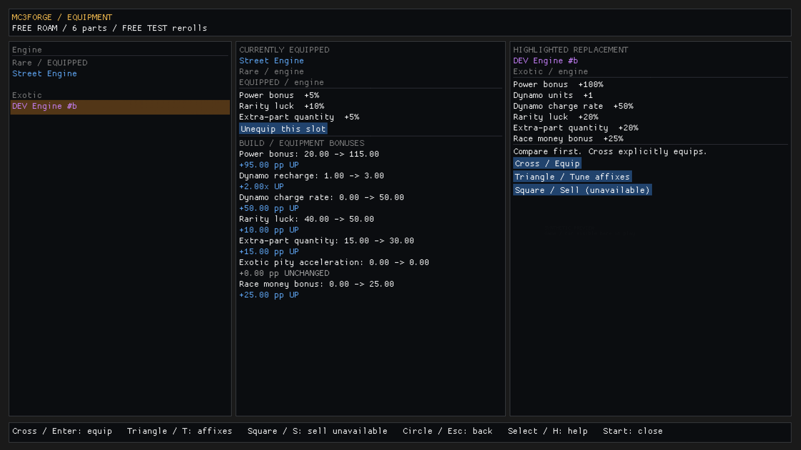

# MC3Forge Community

**v0.1.0-preview — first public source/developer preview. No ready-to-play emulator binary is included.**

An experimental loot-and-equipment addon for the **PS2 version of Midnight Club 3: DUB Edition Remix with VIP 1.1-A**. Earn parts, assemble an eight-slot build, compare replacements, and reroll affixes through an in-renderer equipment menu inspired by action RPGs. MC3Forge is independent community work, developed with AI assistance, and is not an official Rockstar, VIP, PCSX2 or Team Ninja release.

## Before downloading

This is **not a drop-in mod for stock PCSX2 or the Xbox/native PC recompilations**. The gameplay UI currently requires a custom PCSX2 build. Copying these files into an ordinary PCSX2 or VIP folder will not enable it. The public source export excludes the private research emulator and all game/BIOS/VIP/car assets, saves and private history.

- **Players:** read [Installation](docs/INSTALL.md). A simple player ZIP is a later release gate; do not overwrite your working emulator or saves.
- **Developers:** start with [Build the runtime](docs/BUILD.md), then use the portable setup/launch helper.
- **Contributors:** [Architecture](docs/ARCHITECTURE.md), [Contributing](CONTRIBUTING.md), [Security](SECURITY.md).
- **Community mods:** [Credits and compatibility](docs/CREDITS.md), including VIP and Midengine's 2024 Mustang.

## What exists

| Feature | Current status |
| --- | --- |
| Race rewards, saved parts, individual slot swaps and additive power | Passed on a local copied-profile setup; broad compatibility unqualified |
| Eight slots | Engine, Nitrous, Tires, Brakes, Transmission, Suspension, two Accessories |
| Rarities | Common, Uncommon, Rare, Exotic; existing four-affix Exotics preserved, new six-affix Exotics supported |
| Equipment screen | Native C++/Dear ImGui: slots left, equipped item middle, candidate right; human controller/navigation check pending |
| Free test rerolls | Keep current / Apply offer with durable transactions and stale-state checks |
| Drift Dynamo | Guarded native nitro charge; advanced stacking remains experimental |
| Race-money affix | New experimental native credit path; automated checks passed, current-route human paid-race test pending |
| Optional DEV Overdrive pack | Deliberately unbalanced build-potential preview; not final endgame balance |
| Divine/Ethereal, set thresholds, level-scaled collision stats | Planned; not enabled |
| Native pause-menu replacement, camera orbit, selling, paid rerolls | Not delivered |

## Controls



The preview uses synthetic items and a blank game-view region; it is not a live game screenshot.

Equipment opens **only in qualified free roam**, using **L1+Start** or **tilde**. Start closes. Select opens help. Cross browses a slot, then explicitly equips a candidate. Triangle focuses affix tuning; Circle backs out. L1/R1 changes slots or help tabs. Mouse controls are available, including **Unequip this slot**. F10 opens the old diagnostic panel. Square explains that selling is unavailable.

Controller input capture and disconnect/release handling still require human testing. The world continues running; this overlay does not pause time. Do not load emulator savestates while testing equipment effects.

## The optional DEV pack

Each of eight DEV parts carries +100% power, +1 Dynamo unit, +50% recharge rate, +20% rarity luck, +20% quantity and +25% race money. All eight calculate to **+800% power (9x baseline), 40x Dynamo progress and +200% money (3x native payout)**. Native ownership/capacity/target limits and the ten-grants-per-launch diagnostic guard still apply. Strong power can produce wheelspin; these are test values, not promises of final balance or future set designs.

The pack is opt-in, clearly marked, never silently equipped, and intended to be removed/rebalanced as systems mature. See [Testing](docs/TESTING.md). Rerolling DEV effects uses ordinary pools and can weaken them.

## Folder guide

```text
runtime/             Python item policy, SQLite persistence and bounded trace collector
runtime/lootlab/     Typed item schema and transaction owner
native/              Original C++ gameplay guards, protocol, UI and input state
tools/               Source integration, portable setup/launch and opt-in dev pack
tests/               Synthetic Python/C++ tests; no game files needed
docs/                Installation, architecture, build, tests, credits, limitations
.github/workflows/   Source-only CI; no private game inputs
.local/              Your generated emulator/profile/data (ignored; never uploaded)
```

No release claims weak-PC performance certification. The audit fixed quadratic inventory duplicate checks, partial status JSON publication and an expensive Dynamo candidate scan while preserving alias checks. Use 1x rendering resolution first on limited hardware. See [Performance and limits](docs/PERFORMANCE.md).

Original project code is **GPL-3.0-or-later**; see [LICENSE](LICENSE). Third-party projects and game/mod assets retain their own terms. Download those from their creators; they are not bundled here.
